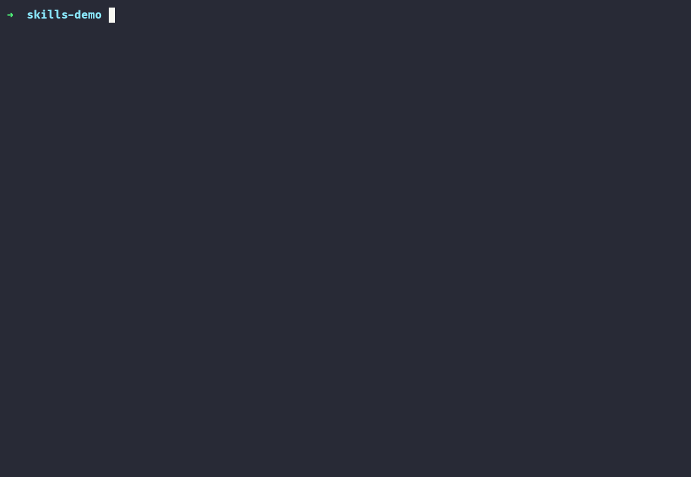

# skm

**Local-first AI coding-skill management: one personal skill library, installed where you choose.**

English | [简体中文](README.zh-CN.md)

[](https://github.com/alswl/skm/actions/workflows/ci.yml)
[](go.mod)
[](https://github.com/alswl/skm/releases)
[](LICENSE)

Claude Code has `~/.claude/skills`. Codex has `~/.codex/skills`. Pi has its own. Every new agent
brings another directory, and your carefully written skills end up copy-pasted into all of them —
drifting, duplicating, and quietly rotting.

`skm` keeps **your own, local-first skill library** of skills and commands and installs them into
every tool you use. Adopt skills you already have locally, or import from GitHub, GitLab, Skills.sh,
and local files. Then batch-update them with one automated command, browse them in a TUI, or script
them in CI. Git is optional for the library; use it when you want versioning or synchronization.



One column per tool. A `✓` means installed there. That's the whole idea.

## Customize community skills

```sh
skm import owner/repo/path/to/skill
skm fork review                  # create a full fork and switch existing installs
skm info review                  # find its editable fork directory
# Edit files directly in that directory.
skm sync diff review             # inspect customization against its baseline
skm update review                # migrate changes, then refresh existing installs
skm install review               # install the active version into new targets
```

`update` generates a fresh patch from the saved upstream baseline and your current
fork, then applies it in an isolated copy of the new upstream. Compatible text
changes are automatic. Incompatible text or complex files can require manual
intervention: the current version stays usable, and `info`/`status` show the saved
workspace. Edit `candidate/` there, then use `skm update review --accept`, or
`--abort` to discard that attempt. A repeated update preserves the workspace.

`skm update review --rollback` restores the content **and baseline** before the
most recent successful update. Later edits block rollback; preserve them yourself
before choosing a version from Git history. Rollback snapshots are local to this
working copy. Installation failures are reported separately; retry `install` for
any target that did not refresh.

`skm fork review --upstream` switches installs back to the current community
version and retains the inactive fork. Future updates leave that fork alone.
Creating another fork at the same location is refused; handle the old directory
manually or explicitly authorize deletion and recreation with `--replace`.
Ordinary `--force` never discards customization or a failed update workspace.

Commit `skills/`, `forks/`, `.skm-sync/`, and the ignore rule to your own Git
repository to preserve content, source associations, and complete baselines.
`.skm-local/` contains temporary patches, failed attempts, transactions, and the
single rollback point; skm adds an exact ignore rule for it. skm never commits for
you. Management directories are excluded from installation and discovery.

Older imported skills without a baseline remain installable but cannot update
safely. `skm sync baseline --help` describes historical restoration and an explicit
new comparison point. Source-only sharing does not include fork content: opting
into `share create --original-source` shares the community address with a warning.
An export references the maintained repository remote, including only what has
actually been published there; `backup` saves an installation list, not contents.

In the TUI, use the actions menu (`x`) to create or leave a fork, accept or cancel
an attempt, or roll back. `p` updates one item; `P` updates the visible items. The
installation repair action (`F`) keeps its existing meaning. Use `--dry-run` for
previews and `--json` for structured results. Text patch operations require Git.

While editing an import address, a static reverse-video cell marks the insertion
point, including with `NO_COLOR`. It does not depend on the terminal's native
cursor or window focus; arrow keys move it without shifting fully visible text.

Git does not track empty directories; retain a placeholder file when a directory must survive a clone.

## ✨ What you get

- 📦 **Local first, fully yours.** Skills live in your personal Git repo: plain directories and
  Markdown, usable offline and easy to commit, branch, review, and back up like any other code.
- 📥 **Import from the platforms you use.** Bring in skills from GitHub, GitLab, Skills.sh, local
  paths, or files — and discover and adopt skills already installed for Claude Code, Codex, and more.
- 🔄 **Automated batch updates in one command.** `skm batch-update` (or `P` in the TUI) updates every
  eligible entry and keeps the result for each one, so there is no repetitive manual cleanup.
- 🔁 **Write once, install everywhere.** `skm install code-review` puts it in every tool that accepts
  skills. No more three copies drifting apart.
- 🔍 **Always know where things stand.** The install columns and `skm status` tell you what's installed
  where, what's dangling, what drifted.
- 🔌 **Built to extend.** Platforms and targets are configuration, not code: `skm target add` connects
  another local destination, while provider and target plugins support custom platforms and install
  behavior — no release required.

Providers say where assets come from; targets say where they get installed. Both ship with
built-ins, and both are pluggable with plain executables — no Go, no rebuilding skm.

| Provider | Brings in |
|---|---|
| Local | A path on disk |
| SelfBuild | A skill/command you author in place |
| GitHub | A repo, a subdirectory, or one file's URL — paste `owner/repo`, `owner/repo/path/to/skill`, or a `blob` link straight from the address bar |
| GitLab | Any GitLab repo |
| Skills.sh | The Skills.sh registry |
| *your own* | Anything a plugin executable can fetch |

| Target | Installs into |
|---|---|
| Claude skills | `~/.claude/skills` |
| Claude commands | `~/.claude/commands` |
| Codex | `~/.codex/skills` |
| pi | `~/.pi/agent/skills` |
| dsh (deepseek-harness) | `~/.dsh/skills` (or `$DSH_HOME`/skills) |
| shared agents | `~/.agents/skills` (or `$DSH_AGENTS_HOME`/skills) |
| *your own* | Any path, via `skm target add` |

## 🏁 Quick start

When the unreleased deploy flow ships, install skm, refresh the current shell's
command lookup, and install all of Matt Pocock's skills into your selected tools
with one command:

```bash
curl -fsSL https://raw.githubusercontent.com/alswl/skm/master/install.sh | sh && export PATH="${SKM_INSTALL_DIR:-${XDG_BIN_HOME:-$HOME/.local/bin}}:$PATH" && hash -r && skm deploy --repo https://github.com/mattpocock/skills.git --target codex,claude-skills
```

skm installs to `~/.local/bin` by default (override with `SKM_INSTALL_DIR`). Deploy
creates a local `./skm/` library first, then links the selected targets. See the
[deploy reference](docs/cli/skm_deploy.md) for details.

## 🚀 First run

Point skm at your skills repo, then just run `skm` — that's the primary way to use it:

```bash
skm init ~/skills && cd ~/skills
skm
```

You get a searchable catalog with one install column per tool, entry detail, a target editor
(`t`), and a task center (`J`) where long-running jobs report progress while you keep browsing.

Don't start from a blank repo — you almost certainly have skills already sitting in
`~/.claude/skills`, `~/.codex/skills`, and the like. Press `o` to discover them, `enter` to adopt
the ones you want into the repo.

| Key | Action |
|---|---|
| `j` / `k` | move · `/` search · `enter` detail |
| `i` | install / uninstall for the selected entry |
| `m` | import · `p` update · `P` update all · `a` archive · `d` delete |
| `o` | discover unmanaged skills · `c` claim one into the repo |
| `x` | all actions for the current entry |
| `t` | targets · `J` task center · `?` full key map |

The footer always shows what's available *right now* — unavailable actions are dimmed, and pressing
one tells you why instead of silently doing nothing. Confirmations spell out the consequence before
anything destructive happens.

### Addressing duplicate names

An entry's repository-relative path is its identity. If two active entries share a name, commands
such as `delete`, `archive`, `install`, and `update` reject the bare name and list the candidate
paths. Re-run the command with one of those paths, for example
`skm delete skills/local/mf-cli --force`. The TUI always uses this exact path for its selected row.

Prefer scripting? Every action has a CLI equivalent:

```bash
skm discover
skm adopt ~/.codex/skills/review
skm import ./my-skill --kind skill
skm install code-review --target codex
skm list
skm status code-review
skm backup create
skm backup restore --force
```

`backup create` snapshots which entries exist and where each one is installed; `backup restore`
puts them back on those targets. It stores no file content — your repo is the source of truth for
that — and `--force` lets the reinstall overwrite whatever occupies an install path now.

Then `git init && git commit` the repository and you're done — your skills are now versioned,
portable, and installed in every tool at once.

## ⚙️ Configuration

Settings resolve **flag > environment variable > settings file > default**, so anything you can put
in a file you can still override for one invocation.

```yaml
# ~/.config/skm/config.yaml — optional; without it nothing changes
root: ~/skills           # same as --root; omit to discover upward from cwd
plugin_dirs:             # scanned after the default ~/.config/skm/plugins
  - ~/work/skm-plugins
targets:                 # custom targets and built-in overrides
  - name: my-tool
    path: ~/.mytool/skills
    accepts: [skill]
    strategies:
      skill: skill-symlink
```

| Setting | Flag | Environment | Notes |
| --- | --- | --- | --- |
| Repository root | `--root` | `SKM_ROOT` | Discovered upward from cwd when unset |
| Extra plugin dirs | — | `SKM_PLUGINS_DIR` | OS path list (`:`-separated); replaces the file's list |
| Config directory | `--config` | `XDG_CONFIG_HOME` | Holds `config.yaml`; defaults to `~/.config/skm` |

`--config` is flag-only by design: the settings file lives *in* the config directory, so it cannot
also choose it.

## 🔌 Plugins

Custom providers and targets live beside the built-ins as plugins — a plugin that's broken, slow, or
hung is isolated and never takes skm down or blocks the others:

```text
~/.config/skm/plugins/
├── providers/   # where assets come from
└── targets/     # how assets get installed
```

Install one instead of symlinking it by hand — `add` links the executable, so edits in your own
checkout take effect immediately:

```bash
skm plugin add ~/ws/skills/skm/plugins/providers/ali-skills   # kind read from providers/
skm plugin add ~/bin/my-target --kind target --name acme-target
skm plugin list && skm plugin remove acme-target
```

For a conventional skill directory, no target plugin is needed: run
`scripts/skm-targets-bootstrap.sh my-tool "$MY_SKILLS_DIR"` to register separate
skill and command targets that share that directory. Use a target plugin only when
the installation layout or diagnostics need custom behavior.

```bash
skm target add --name my-tool --platform mytool --path ~/.mytool/skills \
  --accepts skill --strategy skill=skill-symlink
skm provider list && skm provider validate
skm target plugin list
```

Protocol, error codes, and working templates: [docs/plugins/README.md](docs/plugins/README.md).

## 📚 Docs & development

Full command reference: [docs/cli](docs/cli/) — or `skm <command> --help` for anything. Driving skm
from a coding agent? [skill/SKILL.md](skill/SKILL.md) is a ready-made skill for that — install it
with `skm import ./skill`. Build from source instead of installing a release:

```bash
git clone git@github.com:alswl/skm.git && cd skm && make build && make install
```

```bash
make build && make test && make lint
```

## License

MIT © Jingchao — see [LICENSE](LICENSE).
